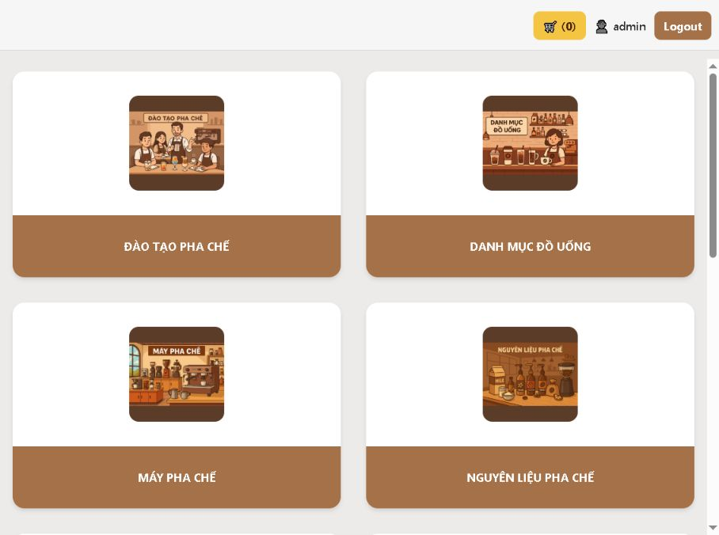
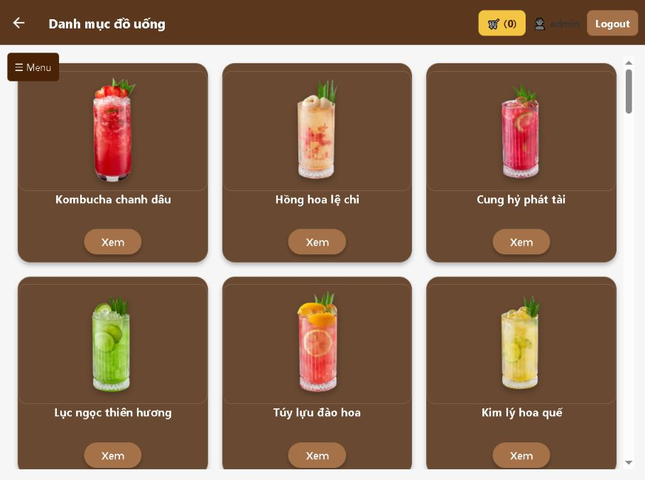
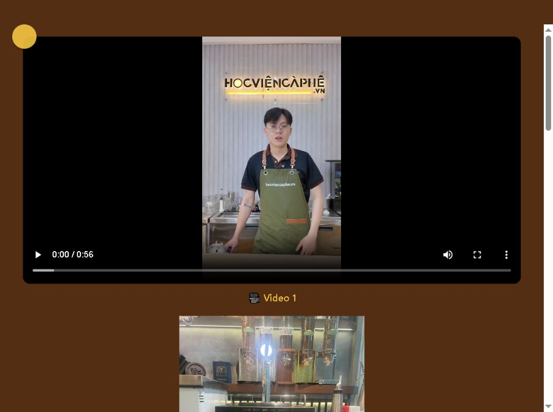
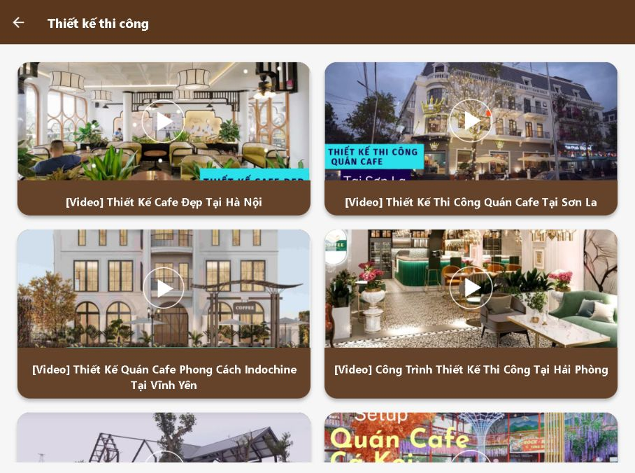

  

<h1 align="center">HVCP PWA</h1>

  Ứng dụng tư vấn bán hàng nội bộ trên máy tính bảng dành cho đội ngũ Sale Học Viện Cà Phê.

  <a href="https://hocviencaphehcm.vercel.app"><strong>Xem ứng dụng đang hoạt động</strong></a>

## Ứng dụng này dùng để làm gì?

HVCP PWA tập trung các nội dung tư vấn của Học Viện Cà Phê vào một giao diện trực quan, giúp Sale dễ dàng giới thiệu dịch vụ khi gặp khách hàng.

Ứng dụng được tối ưu cho tình huống Sale cầm máy tính bảng tư vấn trực tiếp: mở nhanh danh mục, cho khách xem hình ảnh và video minh họa, giới thiệu sản phẩm – dịch vụ, sau đó hỗ trợ khách lựa chọn phương án phù hợp ngay trong buổi trao đổi.

## Cách Sale sử dụng

1. Mở ứng dụng trên máy tính bảng và chọn nhóm nội dung khách hàng quan tâm.
2. Trình bày đồ uống, thiết bị, nguyên liệu, khóa học hoặc dịch vụ bằng hình ảnh trực quan.
3. Mở video, hình ảnh và thông tin chi tiết để khách hàng dễ hình dung phương án thực tế.
4. Tổng hợp nhu cầu và tiếp tục tư vấn các dịch vụ liên quan trong cùng một ứng dụng.

## Giao diện thực tế

### Danh mục dịch vụ

Màn hình chính chia nội dung thành các nhóm rõ ràng như đào tạo pha chế, danh mục đồ uống, máy pha chế, nguyên liệu, Nitro Soda và thiết kế thi công. Sale có thể chuyển nhanh giữa các nội dung mà không phải tìm kiếm tài liệu rời rạc.

### Danh mục đồ uống

Các món được trình bày theo dạng thẻ hình ảnh, phù hợp để cùng khách hàng tham khảo ý tưởng menu. Từ đây, Sale có thể mở từng món để giới thiệu cụ thể hơn về sản phẩm.

### Tư vấn Máy Nitro Soda

Nội dung kết hợp video và hình ảnh thực tế, giúp khách hàng hiểu trực quan về thiết bị, cách vận hành và khả năng ứng dụng Nitro Soda trong mô hình kinh doanh đồ uống.

### Tham khảo thiết kế và thi công

Thư viện công trình và video mẫu giúp Sale trao đổi với khách hàng về phong cách, quy mô và định hướng không gian quán ngay trong buổi tư vấn.

## Nội dung hỗ trợ tư vấn

- Đào tạo pha chế và các khóa học.
- Danh mục đồ uống, công thức và hình ảnh minh họa.
- Máy pha chế, thiết bị và nguyên liệu.
- Dịch vụ setup menu và trọn bộ giải pháp mở quán.
- Máy Nitro Soda và nội dung hướng dẫn liên quan.
- Mẫu thiết kế, thi công và công trình tham khảo.
- Đánh giá dịch vụ, giỏ hàng và thanh toán.

## Giá trị mang lại

- Giúp Sale mang theo một bộ tài liệu tư vấn thống nhất trên máy tính bảng.
- Tăng tính trực quan khi trao đổi với khách hàng bằng hình ảnh và video thực tế.
- Rút ngắn thời gian tìm kiếm thông tin trong quá trình tư vấn.
- Giúp khách hàng dễ hình dung các sản phẩm, dịch vụ và phương án triển khai.
- Có thể sử dụng trực tiếp trên trình duyệt hoặc cài như một ứng dụng PWA.

## Vai trò của tôi

Tôi phụ trách toàn bộ quá trình phân tích nhu cầu sử dụng, xây dựng giao diện, tổ chức nội dung, tích hợp chức năng, kiểm thử và triển khai ứng dụng.

ChatGPT được sử dụng như một công cụ hỏi đáp và tham khảo trong quá trình thực hiện; các quyết định triển khai, viết mã, tích hợp, kiểm thử và đưa sản phẩm lên môi trường thực tế do tôi trực tiếp thực hiện.

## Thông tin dự án

| Hạng mục | Thông tin |
| --- | --- |
| Đối tượng sử dụng | Đội ngũ Sale Học Viện Cà Phê |
| Thiết bị chính | Máy tính bảng; đồng thời hỗ trợ Web/PWA |
| Mục đích | Tư vấn trực tiếp cho khách hàng |
| Phạm vi | Ứng dụng nội bộ |
| Công nghệ chính | Expo, React Native, React Native Web |
| Phiên bản đang hoạt động | [hocviencaphehcm.vercel.app](https://hocviencaphehcm.vercel.app) |

## Bản quyền

Mã nguồn và nội dung thuộc Học Viện Cà Phê. Dự án được duy trì cho mục đích sử dụng nội bộ.
