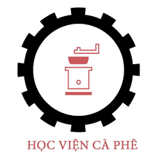
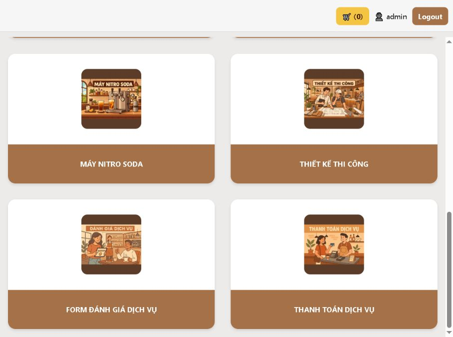

<p align="center">
  
</p>

<h1 align="center">HVCP PWA</h1>

<p align="center">
  Cổng dịch vụ nội bộ đa nền tảng dành cho Học Viện Cà Phê.
</p>

<p align="center">
  <a href="https://expo.dev/"></a>
  <a href="https://reactnative.dev/"></a>
  
  <a href="https://hocviencaphehcm.vercel.app"></a>
</p>

<p align="center">
  <a href="https://hocviencaphehcm.vercel.app"><strong>Mở ứng dụng production</strong></a>
</p>



## Giới thiệu

HVCP PWA tập trung các nội dung và công cụ phục vụ hoạt động tư vấn của Học Viện Cà Phê trong một giao diện thống nhất. Ứng dụng hỗ trợ Web/PWA, Android và iOS trên cùng nền tảng Expo + React Native.

Đây là ứng dụng sử dụng nội bộ. Màn hình đăng nhập, dữ liệu danh mục và nội dung media hiện được đóng gói trực tiếp cùng dự án.

## Tính năng chính

- Đào tạo pha chế và nội dung khóa học.
- Danh mục đồ uống, công thức và media minh họa.
- Máy pha chế, thiết bị và nguyên liệu.
- Trọn bộ dịch vụ và setup menu.
- Máy Nitro Soda.
- Thiết kế và thi công quán.
- Đánh giá dịch vụ.
- Giỏ hàng và thanh toán bằng mã QR.
- Lưu phiên đăng nhập và giỏ hàng bằng AsyncStorage.

## Công nghệ

| Thành phần | Công nghệ |
| --- | --- |
| Nền tảng | Expo 52 |
| Giao diện | React 18, React Native 0.76, React Native Web |
| Điều hướng | React Navigation |
| Lưu trữ phía client | AsyncStorage |
| Web bundler | Metro |
| PWA | Web manifest và service worker hook |
| Triển khai | Vercel |

## Bắt đầu

### Yêu cầu

- Node.js 22.x
- npm

### Cài đặt

```bash
git clone https://github.com/kaizy1227/HVCP-PWA-2.git
cd HVCP-PWA-2
npm install
npm run web
```

Expo sẽ khởi chạy bản web và hiển thị địa chỉ local trong terminal.

## Các lệnh thường dùng

| Lệnh | Công dụng |
| --- | --- |
| `npm start` | Khởi chạy Expo development server |
| `npm run web` | Chạy ứng dụng trên web |
| `npm run android` | Chạy trên Android |
| `npm run ios` | Chạy trên iOS |
| `npm run lint` | Kiểm tra mã nguồn bằng Expo ESLint |
| `npm test` | Chạy Jest ở chế độ watch |
| `npm run build:web` | Xuất bản web tĩnh vào `dist/` |

## Cấu trúc dự án

```text
HVCP-PWA-2/
├── app/
│   ├── components/       # Thành phần giao diện dùng chung
│   ├── context/          # State giỏ hàng
│   ├── data/             # Dữ liệu danh mục và nội dung
│   ├── images/           # Ảnh được bundle cùng ứng dụng
│   ├── models/           # Model dữ liệu
│   └── screens/          # Các màn hình chính
├── assets/               # Icon, splash và tài nguyên Expo
├── public/
│   ├── icons/            # Icon PWA
│   ├── images/           # Ảnh public
│   ├── videos/           # Video public
│   ├── manifest.json     # Web app manifest
│   └── service-worker.js # Service worker
├── scripts/              # Script hậu xử lý bản build
├── app.json              # Cấu hình Expo
├── vercel.json           # Cấu hình triển khai Vercel
└── package.json
```

## Cập nhật nội dung

| Nội dung | Vị trí |
| --- | --- |
| Danh mục dịch vụ, khóa học, đồ uống và sản phẩm | `app/data/dummy-data.js` |
| Ảnh thẻ ở màn hình dịch vụ | `app/images/ServicesScreen/` |
| Media theo từng màn hình | `public/images/`, `public/videos/` |
| Cấu hình PWA | `public/manifest.json`, `public/service-worker.js` |
| Hậu xử lý manifest sau build | `scripts/inject-manifest.js` |

Ảnh thẻ dịch vụ hiện dùng khung vuông `1080 × 1080`. Khi thay ảnh nên giữ đúng kích thước và kiểm tra lại khả năng đọc tiêu đề ở kích thước thumbnail.

## Build và triển khai

Tạo bản web production:

```bash
npm run build:web
```

Bản build được xuất vào thư mục `dist/`. Nhánh `main` được kết nối với Vercel project `hocviencaphehcm`; mỗi commit mới trên nhánh này sẽ kích hoạt deployment production.

- Production: <https://hocviencaphehcm.vercel.app>
- Build command: `npm run build:web`
- Output directory: `dist`

## Trạng thái PWA

Ứng dụng đã có manifest, icon cài đặt và service worker hook. Chế độ cache/offline toàn phần chưa được bật; cần kiểm thử riêng trước khi sử dụng ứng dụng trong môi trường mất kết nối.

## Quy ước làm việc

- Không commit khóa truy cập, token hoặc webhook mới vào repository.
- Tối ưu ảnh và video trước khi đưa vào `public/` để hạn chế dung lượng deployment.
- Build bản web trước khi đưa thay đổi lên `main`.
- Chỉ stage và commit các file thuộc đúng phạm vi thay đổi.

## Bản quyền

Mã nguồn và nội dung thuộc Học Viện Cà Phê. Dự án được duy trì cho mục đích sử dụng nội bộ; không tự động cấp quyền sao chép, phân phối hoặc tái sử dụng khi chưa có chấp thuận.

